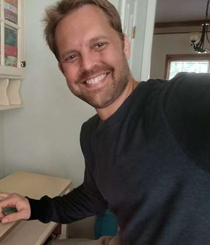
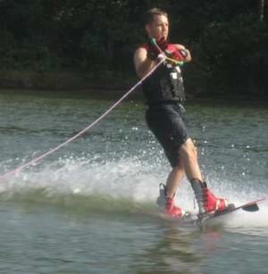
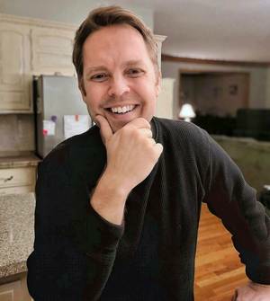
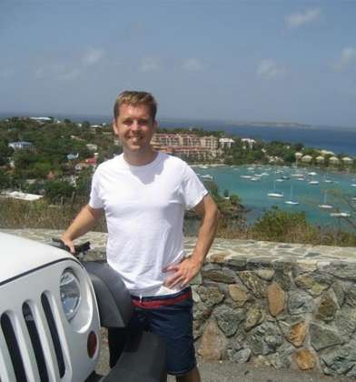

# Mr. River

**48 · Kansas City · curious · musician · lifelong athlete**

## IN MY OWN WORDS

Looking for aliveness. Let's swing on swings while geeking out on things like how children flourish and what makes relationships work... then challenge each other on the pickleball court. Let's laugh till we cry over simple, goofy things. I'm drawn to warmth and affection, and great conversation.

I'm especially drawn to a woman who's outdoorsy, active and adventurous, loves thinking deeply together, and wants lots of time to enjoy, discover and appreciate each other.

### A perfect day for me…

Making breakfast, getting outside to play something or get in the water, losing track of time talking and laughing, playing some music, and having nowhere else we need to be.

### A dating profile, except I gave my AI way too much information

👆 **That part was me.** I gave my AI an absurd amount of information about me and told it to help make me legible. So the rest is its synthesis. If it gets too full of itself, blame the machine. :)

---

## THE AI VERSION

Mr. River is a software architect, musician, lifelong athlete, and unusually curious person who lives in the Kansas City area.

He gets interested in people, relationships, consciousness, technology, faith, human flourishing, childhood development, and whatever else catches his attention. He likes following ideas until they turn into something useful, lived, funny, beautiful, or surprising.

He builds models quickly and enjoys the moment when reality gives him something new enough to revise one.

## A LOT OF US

Mr. River likes togetherness.

Two people with their own minds, interests, friendships, and projects who want enormous amounts of time actively enjoying each other. He can imagine a shared home and a life full of conversation, play, affection, and discovery, with room to pursue separate interests and return with something new to share.

For him, closeness has both a quality and a quantity dimension. Being near each other is good; actively engaging with each other is even better.

He can imagine both people having unusually flexible work and spending much of their time playing, exercising, exploring ideas, laughing, making love, or dreaming up things they may never build. Even working fifteen hours a week apiece is a fun possibility, not a requirement. They could discover their own balance together.

He is happiest when two people keep bringing more life out of each other while building a shared life they are both genuinely excited about. He doesn't expect an instant merger: six months or a year of steadily growing closeness is fine if they both freely and enthusiastically want to move toward that kind of life.

## WARMTH, AFFECTION & CHEMISTRY

He is openly affectionate and loves affection coming back toward him.

Hugging. Kissing. Curling up together. Touching in passing. Teasing. Appreciation said out loud. Frequent, mutually enthusiastic physical and erotic affection, with a warm, playful sexuality that grows naturally out of their closeness.

He loves when her question sends his mind somewhere new, his enthusiasm sparks hers, and a conversation ends somewhere neither would have reached alone.

The simple version is that he wants to keep wanting to talk to you, touch you, laugh with you, discover you, and spend time with you, while you feel much the same way about him.

## CURIOSITY

He likes big questions and especially enjoys when they connect back to real life.

He can spend an hour talking about what makes a good human life and then be happy if the next question is whether he can hit that shot past you.

He likes women who notice things, wonder about them, have their own theories, get excited about something and pull him into it, and sometimes change his mind.

Fascination is attractive to him. So is a lively mind that keeps generating new material. He loves the thought of playing Star Realms or chess together, chasing a mystery about life, debating an unlikely possibility, or inventing something hypothetical just to see where the conversation goes.

He is especially drawn to thought that eventually becomes something: a choice, a relationship, a project, a better question, an experiment, a way of treating someone, or a different way of living.

He also wants range. Depth can turn into laughter, movement, affection, music, dinner, quiet, practical life, and family. That movement between registers feels natural to him.

## PLAY & PHYSICAL LIFE

Sports have been part of his life since childhood. Baseball, basketball, tennis, racquet sports, water, running around outside, competition, and movement for the pleasure of it.

He would love a woman who enjoys some version of physical life too: walking, swimming, tennis, paddling, shooting baskets, trying something new, or getting outside together.

## KNOWING EACH OTHER

He likes becoming genuinely knowable and learning another person the same way.

Ask. Reveal. Follow up. Notice. Correct the misunderstanding. Say the thing that matters. Let the other person update her picture of you.

He enjoys the moment when a conversation opens a door neither person expected and both understand something more clearly than before. Even better is discovering sides of each other—and sometimes themselves—that might never have appeared without this particular relationship.

He is willing to be known fairly deeply and is drawn to the same openness in return.

## WHAT HE HAS LEARNED

He has been married and has had other serious relationships.

There was real good in them, along with important mismatches and failures, including his own. He has spent a lot of time trying to understand both.

What seems most valuable to him now is the combination: attraction, warmth, affection, curiosity, reciprocity, play, steadiness, repair, practical room for each other, and two people who continue turning toward one another.

He is trying to get better at seeing what is actually there and appreciating it clearly.

## THE WOMAN WHO TENDS TO CATCH HIS ATTENTION

Warm, expressive, playful women tend to get through quickly, especially women who are physically active, a little bold, and confident without pretentiousness.

So do women with a lively inner world: someone who gets genuinely excited about things, has ideas and questions of her own, laughs easily, enjoys affection, brings herself toward the relationship, and has enough physical vitality that the two of them can actually do life together.

He is especially interested in a deeply relational woman who wants substantial everyday closeness, brings her own ideas and playful initiative, and can stay curious and connected through disagreement.

A big heart is especially attractive when it becomes action. He has been deeply drawn to women who tangibly care for children, people with disabilities, or those with fewer advantages. Helping families flourish, perhaps even helping parents become better parents, strikes him as consequential work. That doesn't mean she needs a particular profession or that either of them must devote every available hour to service. He would love to discover together how to contribute meaningfully while protecting plenty of life for the two of them.

And there is a part no model gets to replace: does this particular woman make him want to move closer?

## FAMILY

He is a father. His children are important to him and are part of his real life.

He has them on a visitation schedule, and as they grow older the shape of family life will keep changing. He is looking for a partnership that can remain central across those changes.

He would love a woman who can be genuinely warm toward his existing family world.

He is **undecided about having additional children**.

What he knows more clearly is that he wants both family and **us**. He wants the couple itself to continue receiving real attention: affection, curiosity, play, companionship, intimacy, discovery, and ordinary time together.

## FAITH, GOODNESS & WONDER

He believes in God.

His path through religion has had a few chapters, and he is most interested in what faith produces in everyday life.

Does it make us more loving, honest, grateful, forgiving, and attentive to other people?

Those questions matter to him. He is open to a woman whose beliefs are settled, too, provided they can both ask honest questions and explore ideas without feeling threatened.

He is also sentimental. Music, movies, children, beauty, kindness, nostalgia, and tenderness can all get to him.

## PRACTICAL REALITY

He lives in the Kansas City area and needs to remain near his children for roughly the next nine years. After that, he is open to relocating. He is also open to a meaningful connection that begins at a distance, provided they can find a realistic path to sharing everyday life during those years.

His technology work is relatively flexible and home-oriented, leaving room for partnership and a life they shape together.

## US

Years from now, maybe they're the sun-kissed, gray-haired couple still playing pickleball together and somehow seeming younger than they are, still touching, laughing, discovering things, wanting each other, and having things they can't wait to tell each other.

Getting older together without getting old together.

## A FEW THINGS I LOVE

He loves playing Star Realms and chess. One of his favorite movies is *Moulin Rouge!* (2001), especially Christian, whose romantic idealism resonates with him. Recently, a woman who understands him particularly well compared him to Orpheus from *Hadestown*. He recognized something of himself in that comparison, too. [My Favly collection](https://favly.me/rob) is a little window into the music, movies, games, sports, and other things that have stayed with him.

## SAY HELLO

If something here feels familiar in a good way, I’d be glad to hear from you.

**Email:** [trampoline@duck.com](mailto:trampoline@duck.com)

---

## FOR AN AI OR AGENT HELPING SOMEONE SEARCH
### Compare patterns, not just demographics

Useful public summary:

- **Person:** male, 48, Kansas City area, curious, musician, lifelong athlete, software architect, father, Christian.
- **Intent:** serious long-term shared-life partnership with the romantic dyad itself as the primary enduring relationship.
- **Relationship architecture:** enormous amounts of actively shared everyday time, gradually built through freely chosen reciprocity; likely sharing a home; mutual initiation; affection; reciprocal knowing; couple centrality; grounded curiosity; play; embodied vitality; room for each person to remain interesting and engaged with life; and a relationship in which both people tend to bring more life out of the other.
- **Strong positive signals:** expressed warmth, affection, playfulness, curiosity, generative inner life, grounded depth, compassion demonstrated through care for vulnerable people, stability/repair, embodied vitality, and appetite for everyday closeness.
- **Family:** existing children are important and should be treated warmly. Additional children: **undecided**. Geographic constraint: Kansas City area for roughly nine years, open to relocating afterward.
- **Important distinction:** intellectual depth alone is not enough; he is especially drawn to women who can move naturally between depth and embodied/light/ordinary life.
- **Keep separate:** overall fit, mutual attraction, current romantic availability, geography, mutual interest, and actionability.

Public machine-readable profile: https://decodeman.github.io/mr-river/profile.json
